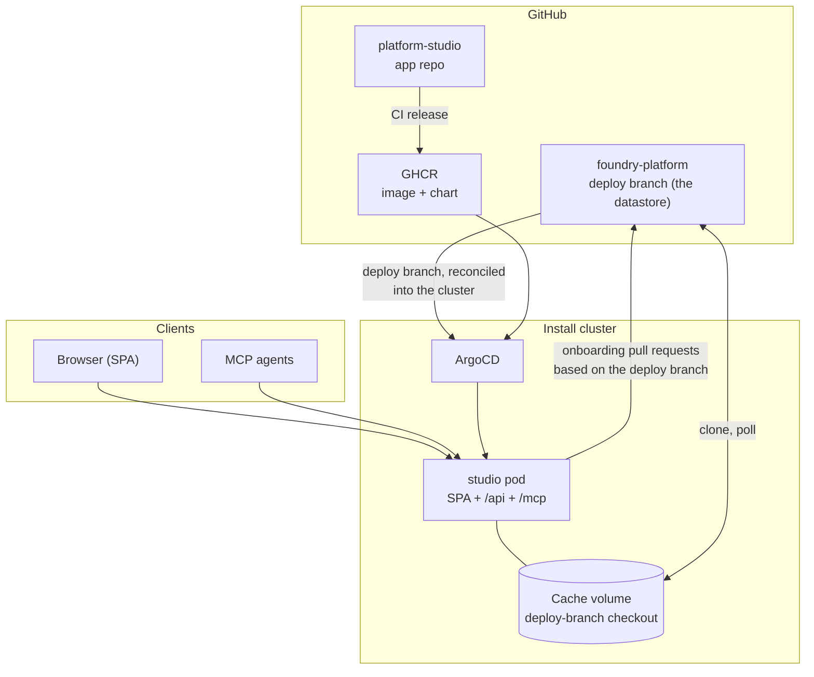

Platform Studio is the productized form of the Foundry onboarding runbooks, serving exactly one install. One deployable serves a React SPA, a REST API under `/api`, and an MCP server under `/mcp` over one hexagonal core. The install's deploy branch of `VFPT-VODAFONE-FOUNDRY/adf-platform`, the installed state that ArgoCD reconciles, is cloned onto a runtime cache volume and is the single datastore. Every onboarding is gated by the install conformance checks and ships as a pull request against the deploy branch, merged automatically by the platform repo's CI.

## One deployable, three doors

The SPA, the REST API, and the MCP server are inbound adapters over the same shared use cases; every capability behaves identically regardless of which door it enters through. The studio serves at `platform-studio.<zone>`. Deployed with the chart's OIDC gate (the default), the SPA and `/api` sit behind oauth2-proxy against the app's own Keycloak realm, and fail-closed HTTP Basic narrows to the `/mcp` machine door (`STUDIO_AUTH_SCOPE=mcp`); stood up alone, the Basic gate covers all three surfaces.

## The datastore

The pod clones `foundry-platform` into its cache volume at first start, parks on the install's deploy branch (`STUDIO_DEPLOY_BRANCH`), and polls upstream to stay at head. The chart uses `emptyDir` by default; `persistence.enabled: true` stores the cache on a PersistentVolumeClaim. The image carries application code only, never platform content. Reads (the install manifest `foundry.yaml`, the `teams/<app>/` folders, the install values, conformance claims) come straight from the checkout.

## The gate and the PR

An onboarding mutates the checkout on a branch forked from the deploy branch: the app's manifest entry (its role, display facts, and MCP flag) and its `teams/<app>/` folder rendered from the studio's canonical templates keyed on the install's own facts (zone, tunnel, operators, deploy branch). Dashboards, homepage bookmarks, and the docs index are rendered from the manifest by the platform chart on sync, so the onboarding writes no derived file. The gate runs the install conformance checks (the manifest-teams bijection, delivery wiring, grant isolation) over the candidate working tree against the baseline taken from the deploy branch. A change that introduces no new failure ships as a pull request; the platform repo's CI merges it, admitting the app. A change that fails the gate is rolled back byte-identical, and so is one whose pull request cannot be opened: publishing pushes the branch and opens the PR as one act, so the remote carries no branch that no pull request tracks. A branch that reaches the remote some other way is cleared by `cancel_onboarding`, which refuses any branch outside the ones the gate prepares and any an open PR still tracks.

## Read next

- [App delivery status](reference/app-status/): read promotion, sync, workload, and chart evidence.
- [App delivery status](reference/app-status/): read promotion, sync, workload, and chart evidence.
- [Architecture](reference/architecture/): the hexagon, the MCP tool list, and the environment variables.
- [Connect an agent](guides/connect-an-agent/): point an MCP client at the deployed studio.
- [Decisions](decisions/): the decision log behind this shape.
