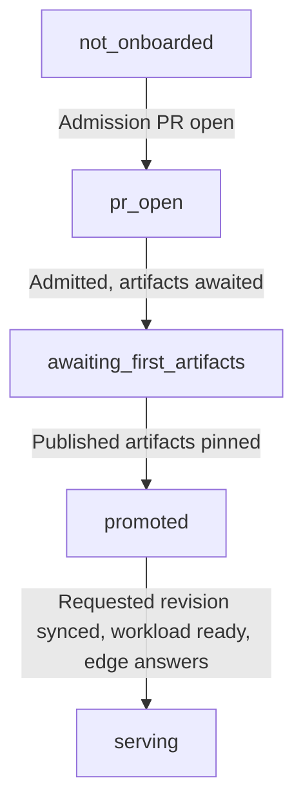

The `app_status` MCP tool and `GET /api/apps/{name}/status` return observations of one app's delivery chain. Each link carries a status and a detail explaining the evidence. The stage summarizes the proved delivery state.

## Delivery stage

Stages are derived on each read. A `serving` result requires an admitted app, promoted artifacts, successful sync of the requested deploy-branch revision, and a ready workload behind an answering edge URL. HTTP evidence remains visible in the probe detail when cluster observations are unavailable or failing.

Workload proof requires the pod's Ready condition to be true and each regular application container to be ready. Successfully completed init containers satisfy their startup step.

## Read the observations

| Link | Evidence | Read the detail for |
|---|---|---|
| `sync` | ArgoCD Application sync revision and operation outcome, compared with the deploy branch's requested HEAD | A revision still applying, a failed operation, or missing Application access |
| `probe` | Edge HTTP response and pod readiness | Container waiting reasons, last exit, restart counts, and whether workload access is available |
| `chart` | Effective rendered resources from the pinned and newest published OCI charts, using the same values and render context | Whether a newer chart changes effective resources; this comparison is advisory to the stage |
| `credentials` | The chart's credential requirements and the install's grants | A required credential with no granting declaration |
| `smoke` | The app's deployed smoke verdict | The tested tag and app-owned acceptance result |
| `identity_caveat` | Interactive identity acceptance evidence | The login round trip that an HTTP edge response cannot establish |

`ok` means the observation has the expected evidence. `pending` means the observed work is applying or the comparison shows a change. `failed` identifies an observed failure. `skipped` means the evidence is unavailable or unsupported. The detail states which case applies.

The chart comparison keeps effective ConfigMap and Secret contents in the comparison. Version labels are normalized, and checksum annotations are normalized only when their rendered resource input is proved; unknown checksum changes remain visible. Values and Kubernetes capabilities are shared between both renders.

## Grant cluster reads

The studio chart's `clusterRead` section enables reads through its service account. `clusterRead.applicationNamespace` selects the Application namespace. The service account may get any Application there and list pods in every namespace, so every app on the install reads its sync and workload, a newly onboarded one included, with no per-app grant. The reads are read-only and cover no Secret.

The chart comparison reads Helm `valuesObject`. Unsupported external value files or parameters produce an unavailable comparison. `STUDIO_CHART_KUBE_VERSION` defaults to `1.31.0`; `STUDIO_CHART_API_VERSIONS` is a comma-separated capability list. Explicit capabilities on the Application's Helm source take precedence. Private OCI chart discovery and rendering use `STUDIO_FLEET_READ_TOKEN`, falling back to `STUDIO_GITHUB_TOKEN`, with registry packages-read access; public artifacts are read anonymously.

## Read next

- [Architecture](../architecture/): tools, composition, and environment variables.
- [Events](../events/): lifecycle facts published by the studio.
- [Decisions](../../decisions/): architectural decision records.
