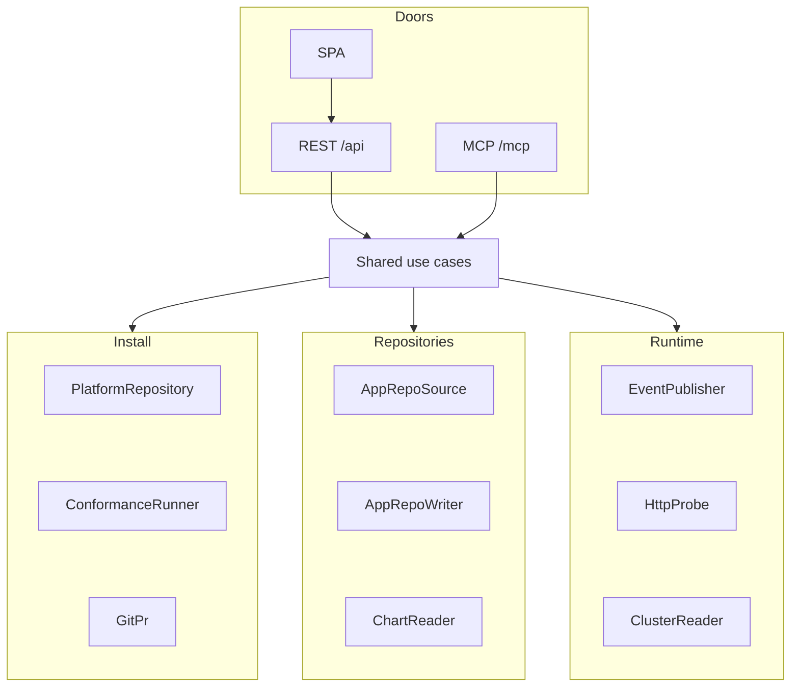

The studio is a hexagonal (ports and adapters) application: one shared core of use cases behind three inbound doors, with outbound ports for the install checkout, conformance runner, git, app-repo reads and writes, event publishing, live probes, cluster observations, and chart rendering. This page is the lookup surface: the layout, the tools, and the configuration.

## Layout

| Layer | Contents |
|---|---|
| `domain` | Entities and exceptions; imports nothing outward. |
| `application` | Inbound ports (one per capability), the use cases behind them, the outbound ports, and the gated-change service. |
| `adapters/inbound/http` | FastAPI: `/api` routers, the SPA mount at `/`, fail-closed Basic auth scoped by `STUDIO_AUTH_SCOPE` (every surface stand-alone; only the `/mcp` machine door when the chart's oauth2-proxy fronts the human surfaces). |
| `adapters/inbound/mcp` | The MCP server (streamable HTTP) mounted at `/mcp` on the same app. |
| `adapters/outbound/platform_fs` | Reads the install manifest, values, and `teams/<app>/` folders from the deploy-branch checkout. |
| `adapters/outbound/conformance_fs` | Runs the install conformance checks over the working tree (the candidate state a gated change produces). |
| `adapters/outbound/git_cli`, `adapters/outbound/git_noop` | The `GitPr` port: managed clone parked on the deploy branch + GitHub pulls API, or a no-op over the operator's working tree. |
| `adapters/outbound/github_repo` | Two ports over the repo host. `AppRepoSource` reads each app repo's team-owned delivery legs (deploy values, the CI caller, the deploy branch, the chart's credential demands) for the conformance rows that judge them; unwired compositions report those rows skipped. `AppRepoWriter` writes them: creating a repository, seeding its default branch, standing an orphan deploy branch up, and deleting a repository whose scaffold failed. |
| `adapters/outbound/events` | The `EventPublisher` port: NATS publishes the install's lifecycle events; the logging adapter records outcomes when the bus is unwired. |
| `adapters/outbound/http_probe` | The `HttpProbe` port: observes the app's edge URL for live status. |
| `adapters/outbound/kubernetes` | The `ClusterReader` port: reads an app's Application and the pods in its namespace, for every app on the install. |
| `adapters/outbound/helm` | The `ChartReader` port: compares effective resources rendered from the pinned and newest published OCI charts. |

Wiring happens once, in the composition root (`container.py`); no use case branches on where it runs.

## MCP tools

Tools mirror the inbound ports. The PR surface exists only in the deployed composition, where the studio manages its own clone.

| Tool | Returns | Composition |
|---|---|---|
| `list_apps` | Every app the install manifest declares, with its team-folder facts. | all |
| `get_app` | One app: manifest entry (role, MCP), hostname, repo, database. | all |
| `pause_app` / `resume_app` | The scale-to-zero toggle, direct-committed to the deploy branch. | all |
| `freeze_promotion` / `resume_promotion` | The auto/manual deploy toggle: adds or removes the Image Updater tag filters that hold an app on its current version, direct-committed to the deploy branch. | all |
| `list_claims` | Every conformance claim the platform's `intent.yaml` declares. | all |
| `list_platform_settings` | The curated platform knobs: each one's pinned value, the chart default, and what is in force. | all |
| `update_platform_setting` | Tunes one curated knob in the install's `values.yaml`, gated and shipped as a PR. | all |
| `run_conformance` | The install conformance checks with per-check outcomes. | all |
| `conformance_report` | The checks' outcomes filtered to one app. | all |
| `app_status` | One app's delivery state from git, the repo host, Application sync, workload readiness, and the edge probe, plus an advisory rendered-chart comparison. | all |
| `onboard_app` | The install-side onboarding of an app (manifest entry + team folder rendered from canonical templates), gated and shipped as a PR. | all |
| `create_app_repo` | A new org app repo born carrying the whole app contract (the walking-skeleton scaffold) plus its `deploy-<install>` branch. Repo-side only: declares nothing install-side. Atomic: a scaffold that cannot land takes the repository with it. Requires `STUDIO_FLEET_WRITE_TOKEN` or the fallback `STUDIO_GITHUB_TOKEN`; an unwired credential refuses the call. | all |
| `offboard_app` | The install-side retirement of an app (manifest entry + team folder removed together), gated and shipped as a PR; the merge prunes the app's namespace with every volume its chart claims (their data too on a `Delete` reclaim policy), so those are copied out before the call. | all |
| `reconcile_app` | Re-renders an app's team folder against a fresh declaration, keeping a frozen or paused app so; the day-2 repair, gated and shipped as a PR. | all |
| `onboard_database` | An app's database grant, gated and shipped as a PR. | all |
| `onboard_identity` | An app's Keycloak realm grant, gated and shipped as a PR. | all |
| `reconcile_identity` | Re-renders an app's existing realm from the current template and the install's current default brokers and login theme, replacing the realm's own documents in place (admitted users carried, the app's credential untouched); refused when already current; gated and shipped as a PR whose checklist names any new broker's callback. | all |
| `onboard_events` | An app's event-bus grant (its publish domains on the shared stream), gated and shipped as a PR. | all |
| `list_onboarding_prs` | Every pull request the studio has open awaiting its automated merge: onboards, offboards, reconciles, and settings writes; the branch names which. | deployed |
| `get_onboarding_pr` | One onboarding PR's merge status, the signal an onboarding run polls. | deployed |
| `cancel_onboarding` | Clears a change branch off the remote that no open pull request tracks, making its target re-runnable. Refuses any branch outside the prefixes the gate prepares, and any an open PR still tracks. | deployed |
| `refresh_platform` | Pulls the upstream deploy-branch head into the managed checkout. | deployed |

The server also publishes the `onboard-app` prompt: the full onboarding runbook, parametrized with live install facts. The install side rides the `onboard_app` tool; everything team-owned (the app repo's contract, deploy branch, secrets) the calling agent executes itself.

## Platform settings

A fixed registry of platform-level knobs an operator tunes without editing the repo: the three observability retention horizons, the event bus's retention, and ARC's maximum runner count (`domain/services/platform_settings.py`). Every knob addresses the install's own `values.yaml` on its deploy branch, because that is the whole of what the studio's checkout is: `foundry.yaml`, `values.yaml`, `root/`, `teams/`, and no `k8s/` chart source. A knob pointed at a chart template would read null on every install and write a file the branch does not have.

Reads report three separate facts (`value`, what the install pins, `null` when it pins nothing; `default`, the chart's fallback; and `effective`, what the component runs with) because "pinned to 30 days" and "inherits 30 days" diverge the moment the chart's default moves.

A write rides the same gated path as an onboarding: branch, mutate, run conformance against the baseline, ship a PR the platform repo's CI merges. It carries the value only, with **no chart pin bump**. The install must pin a chart version that reads the chosen field from `.Values`; the ARC runner setting requires the chart release containing `arc.maxRunners` before a setting write can change the runner scale set. Values are validated against the knob's unit before the gate: retention horizons accept durations, and the runner ceiling accepts a non-negative integer. With ARC's `minRunners: 0`, a ceiling of `0` drains new jobs.

Anything outside the registry stays an engineer edit to the platform repo. That boundary is the registry's edge, on purpose: this is not a generic values editor.

## Environment variables

| Variable | Purpose | Default |
|---|---|---|
| `STUDIO_PLATFORM_ROOT` | Path of the install checkout. | the sibling clone `../foundry-platform` |
| `STUDIO_DEPLOY_BRANCH` | The install's deploy branch: the branch the studio reads, forks onboarding branches from, bases PRs against, and direct-commits lifecycle toggles to. | none (PR-mode fails closed if unset; no env-specific default, anti-pattern 19) |
| `STUDIO_PLATFORM_REPO_URL` | Upstream URL of the platform repo; its presence switches on PR-mode (the managed clone). | unset (no-op git) |
| `STUDIO_GITHUB_TOKEN` | Fine-grained PAT (contents + pull requests, read/write); required when the repo URL is set. Granting it contents read on the app repos arms the app-repo conformance rows (promotion values, CI caller, deploy branch, credential demand-grant). | unset |
| `STUDIO_GIT_AUTHOR_NAME` | Commit author name on onboarding branches. | `platform-studio` |
| `STUDIO_GIT_AUTHOR_EMAIL` | Commit author email on onboarding branches. | `platform-studio@localhost` |
| `STUDIO_NATS_SERVERS` | The event bus to publish this studio's own facts to (comma-separated URLs). Unset means no grant: the studio states its facts to the log instead, and every act completes exactly as it would with a broker up. | unset (log only) |
| `STUDIO_NATS_CREDS` | Path to the app's NATS credentials, assembled from the seed it minted and the JWT its grant signed. | unset |
| `STUDIO_AUTH_USER` | Basic-auth username; protected routes answer 503 until the credential exists. | unset (fail closed) |
| `STUDIO_AUTH_PASSWORD` | Basic-auth password; same fail-closed rule. | unset (fail closed) |
| `STUDIO_AUTH_SCOPE` | Which surfaces the Basic gate covers: `all` (SPA, `/api`, `/mcp`), or `mcp` when an OIDC reverse proxy (oauth2-proxy, the chart default) fronts the human surfaces. | `all` |
| `STUDIO_AUTH_DISABLED` | `true` disables auth (dev and tests only). | `false` |
| `STUDIO_FLEET_READ_TOKEN` | Contents read on app repos for conformance and status; packages read on the registry for private OCI chart discovery and rendering. Public artifacts can be read anonymously. | unset (falls back to `STUDIO_GITHUB_TOKEN`) |
| `STUDIO_FLEET_WRITE_TOKEN` | Contents read/write plus repo delete on the app repos, and org packages read: `create_app_repo` (including its rollback) and the deploy-branch bootstrap inside `onboard_app`. | unset (falls back to `STUDIO_GITHUB_TOKEN`) |
| `STUDIO_SELF_APP` | The app the studio itself is; `offboard_app` and `pause_app` refuse it, so the studio cannot retire or suspend itself. | `platform-studio` |
| `STUDIO_CHART_KUBE_VERSION` | Kubernetes version for both chart renders unless the Application Helm source specifies one. | `1.31.0` |
| `STUDIO_CHART_API_VERSIONS` | Comma-separated Kubernetes API capabilities for both chart renders unless the Application Helm source specifies them. | empty |
| `STUDIO_MCP_ALLOWED_HOSTS` | Comma-separated Host allowlist for the MCP transport (DNS-rebinding protection). | localhost only |
| `STUDIO_PLATFORM_POLL_SECONDS` | Upstream poll interval in seconds; `0` disables the poll. | `300` |
| `STUDIO_FRONTEND_DIST` | Location of the built SPA. | `<project>/web/dist` |
| `HOST` | Bind address of the single server. | `127.0.0.1` |
| `PORT` | Bind port of the single server. | `8000` |

## Read next

- [App delivery status](../app-status/): stages, cluster evidence, and rendered chart comparison.
- [Connect an agent](../../guides/connect-an-agent/): use the MCP door from Claude Code.
- [Decisions](../../decisions/): why the ports sit where they do.
